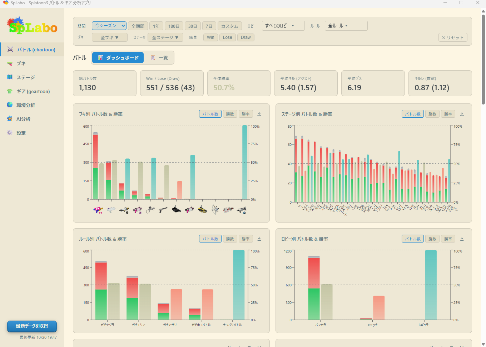
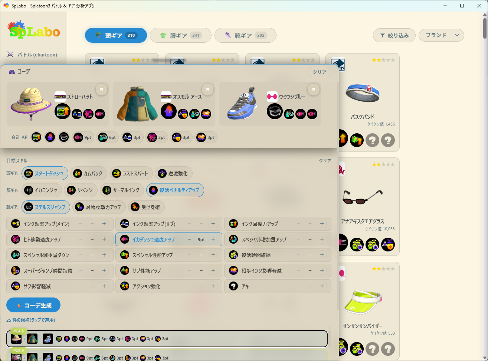
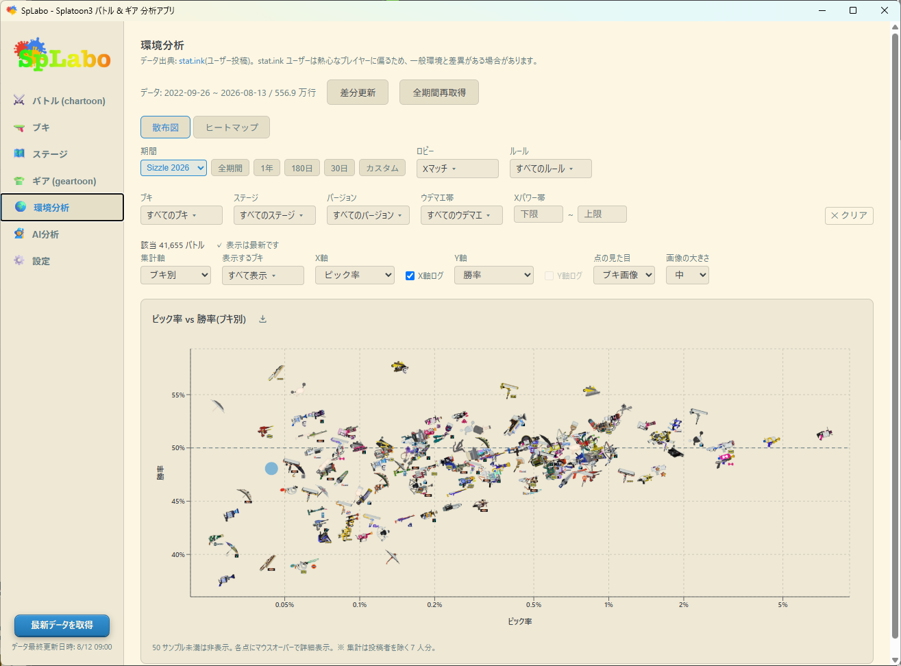
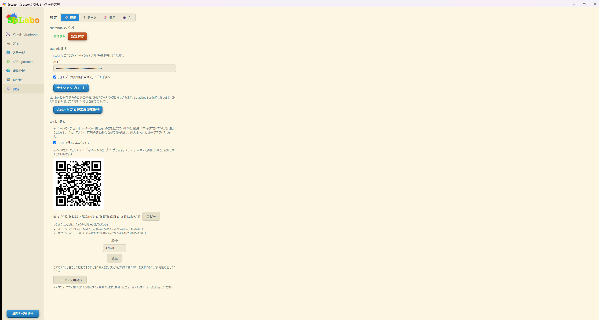

# スプラボ (splabo)

[English README](README_en.md)

Nintendo アカウントから [nxapi](https://github.com/samuelthomas2774/nxapi) が解析した非公式 API 経由で Splatoon 3 のバトル履歴・所持ギアを取得し、可視化・分析する OSS の PC アプリです。任天堂株式会社とは無関係です。

> ## 📢 chartoon は splabo になりました
>
> - 戦績可視化・分析アプリ **chartoon** はギア管理アプリ **geartoon** と統合し、名称を **splabo** に、1 バイナリ（識別子 `com.splabo.app`）に変更しました。
> - **「ギア」タブ**で所持ギアの取得・閲覧・コーデ（ギア構成）組みができます（旧 geartoon の機能を統合）。
> - **設定・戦績データ・ギアデータはそのまま引き継がれます**。旧 `com.chartoon.app` / `com.geartoon.app` のデータは splabo 初回起動時に**非破壊コピー**で自動移行されます（`app/src-tauri/src/migration.rs`）。

バグ報告・機能要望・感想など、フィードバックは[フィードバックフォーム](https://docs.google.com/forms/d/e/1FAIpQLSd2m8eNn4HwTjOY1PMnecJvSH95QCJxNi0Lyy1w4zxhIdndrQ/viewform)からお気軽にどうぞ（匿名可）。

🌐 **ダウンロードページ**: [https://splaboon.pages.dev/](https://splaboon.pages.dev/)（[English](https://splaboon.pages.dev/en/)）

```
splabo/
├─ app/          # Tauri アプリ本体（Vite + React + recharts + Rust/SQLite）
│  ├─ src/       #   フロント（戦績 components/ ＋ ギア gear/・.gear-root スコープ）
│  └─ src-tauri/ #   Rust（auth / statink / gear.rs / gear_crypto.rs / migration.rs / companion.rs / web_api.rs + SQLite）
├─ tools/        # nxapi サイドカーのビルド環境（nxapi-wrapper・AGPL-3.0-or-later）とライセンス一覧の生成（licenses）
├─ docs/         # GitHub Pages（splaboon.pages.dev）
├─ .github/      # CI（ci.yml）+ リリース（splabo-release.yml）
├─ package.json  # npm workspaces（app）
└─ Cargo.toml    # Cargo workspace + [workspace.dependencies]
```

## 機能

- **戦績** — タブ内で「ダッシュボード」と「一覧」を切り替えられます
  - ダッシュボード: ブキ別・ロビー別・ステージ別の勝率をグラフで表示。バトル数カレンダー（月の 1 日から新しい列が始まります）やカスタムグラフも
  - 一覧: バトル履歴を一覧表示（ページング対応）。詳細モーダルでチーム編成・ギア・ランク / X パワー変動を確認できます
- **ブキ** — 「パネル」と「一覧」を切り替え可能。一覧は列見出しのクリックで並び替えでき、カテゴリ / サブ / スペシャルで絞り込めます。公式アプリの熟練度・通算勝利・通算塗りP・ブキチャレパワーも出せます。詳細では「よく戦うステージ」「勝率の良いステージ」やルール別勝率を確認できます
- **ステージ** — 「パネル」と「一覧」を切り替え可能。自分の戦績に加え、公式アプリのルール別通算勝率を表示します
- **ギアコーデ** — 所持ギアを取得して一覧表示。ギアパワーを組み合わせてコーデ（ギア構成）を組み、タイトルとメモをつけて保存できます（旧 geartoon の機能を統合）
- **環境分析** — [stat.ink](https://stat.ink/) の公開バトルデータを取り込み、ブキピック率・勝率などコミュニティ全体の環境を散布図・マトリクスヒートマップで分析。取得の開始日は設定の「データ」で選べます（既定は 2025.1.1〜）。期間・ロビー・ルール・ブキ（カテゴリ見出しで一括選択）・ステージ・バージョン・ウデマエ帯（全期間 / 今シーズン / 1年 / 180日 / 30日 / カスタム）で絞り込み可能。条件に合う該当バトル数も表示します。集計は stat.ink の全体統計と同じく、投稿者本人を除いた 7 人を母数にします
- **stat.ink 自動アップロード** — 取得したバトルを [stat.ink](https://stat.ink/) へ自動アップロード（API キー登録時）。同一バトルは s3s と同じ UUID v5 名前空間で重複排除されます
- **パネルの保存** — ダッシュボードと環境分析の各パネルを **PNG** または **HTML** として保存できます。保存ボタンはパネル右上。画像／HTML にはタイトル・絞り込み条件・splabo ロゴ・クレジットが入り、PNG では角丸の外側は透明です。HTML はブラウザで開いて散布図のツールチップをホバー確認でき、ブキ画像の散布図では重なりをばらけさせる動きもそのまま動きます
- **AI 分析** — 自然言語で質問すると SQL を生成し、**この PC の中だけで集計**して表・グラフで表示（OpenAI / Google Gemini / Anthropic Claude / xAI Grok 対応）
- **自動取得** — 15 分〜24 時間ごとの定期間隔でバトルデータをバックグラウンドで取得し、続けてギアも更新します（ギア失敗でもバトル取得の成功は維持）。有効時はウィンドウを閉じてもトレイに常駐し、完了をシステム通知でお知らせ。既定は 1 時間ごと（理由は[取得間隔と認証](#取得間隔と認証)）
- **スマホで見る** — 同じネットワークのスマホのブラウザから、戦績・ブキ・ステージ・ギアを見られます。アプリのインストールは不要です（[スマホで見る](#スマホで見る)）

> **絞り込みについて**: ブキ・ステージも上部の絞り込み（期間・ロビー・ルール・結果）に対応しています。公式アプリから取る熟練度・通算勝利・通算塗りP・ブキチャレパワー・ステージの通算勝率は全期間の値なので、絞り込みを変えても変わりません。ダッシュボードのグラフ軸にも、これらの公式値を選べます。

## スクリーンショット

<table>
  <tr>
    <th>ダッシュボード</th>
    <th>ギアコーデ</th>
  </tr>
  <tr>
    <td></td>
    <td></td>
  </tr>
  <tr valign="top">
    <td>ダッシュボードでバトル結果を分析</td>
    <td>目標スキルからギアコーデを自動生成</td>
  </tr>
  <tr>
    <th>環境分析</th>
    <th>スマホで見る</th>
  </tr>
  <tr>
    <td></td>
    <td></td>
  </tr>
  <tr valign="top">
    <td>stat.ink の公開データで環境を分析</td>
    <td>設定の QR で同じネットワークのスマホから見る</td>
  </tr>
</table>

## スマホで見る

PC の splabo をサーバーにして、同じネットワーク（同じルーター）につながったスマホのブラウザから見られます。PC が有線 LAN でも問題ありません。スマホにアプリを入れる必要はありません。

### スマホでできること

- **バトル** — 総バトル数・勝率・平均キルなど 6 つの数字と、PC と同じダッシュボードのグラフ（作ったカスタムグラフも）、直近のバトル。グラフは画面いっぱいに広げて見られます。グラフの追加・編集・削除・並べ替えもでき、PC のダッシュボードにもすぐ反映されます
- **ブキ・ステージ** — ブキごと・ステージごとの成績
- **ギア** — 所持ギア・コーデ・保存コーデ。スマホでコーデを組んで保存することもできます
- 期間・ロビー・ルールで絞り込めます（選んだ条件と開いていたタブはスマホが覚えています）
- 右上の更新ボタン（丸矢印）で、PC に任天堂から最新のデータを取りに行かせます

並び順など PC で決めた設定は、スマホにもそのまま使われます。グラフ以外の設定の変更は PC で行います。

### はじめかた

1. PC の splabo で **設定 → 連携 → スマホで見る** の「スマホで見られるようにする」をオンにします
2. 出てきた QR コードをスマホのカメラで読み取ると、ブラウザで開きます

オンにしておくと、次からは splabo の起動時に自動で始まります。

### ホーム画面に追加する

一度開いたら、ホーム画面に追加しておくと次からアイコンで開けます。

- **iPhone（Safari）**: 共有ボタン →「ホーム画面に追加」
- **Android（Chrome）**: 右上の ︙ →「ホーム画面に追加」。上のバーの「全画面」ボタンを押すと、ブラウザのバーを消して全画面で見られます

### 使えるとき・使えないとき

- PC で splabo が起動している間だけ使えます（ウィンドウを閉じてトレイに常駐している間も使えます）。PC がスリープしていると見られません
- 同じネットワーク（同じ家のルーター配下）の中でだけ使えます。外出先のモバイル回線からは見られません

### つながらないとき

- **スマホと PC が同じネットワーク（同じルーター）につながっているか**確認してください。PC が有線でも大丈夫です。ゲスト用 Wi-Fi は、ほかの端末と通信できない設定になっていることがあります
- **Windows**: ネットワークが「パブリック」だと、Windows ファイアウォールがスマホからの接続を止めます。「プライベート ネットワーク」に変えてください（設定 → ネットワークとインターネット → 現在の接続 → ネットワーク プロファイルの種類）。初めてスマホからつないだときに許可ダイアログが出たら、プライベートにチェックして許可します。設定画面にも、この状態のときは注意が出ます。プライベートにしてもつながらないときは、以前パブリックのまま許可した規則だけが残っていることがあります。この状態は設定画面が見つけて知らせるので、その説明に沿って Windows ファイアウォールの受信の規則（splabo・TCP と UDP の 2 つ）でプライベートにチェックしてください
- **Linux**: ファイアウォール（ufw など）を有効にしているときは、ポート（既定 47620）への受信を許可してください（例: `sudo ufw allow from 192.168.0.0/16 to any port 47620 proto tcp`）
- **ほかのアプリとポートが重なって始まらないとき**: 設定の「ポート」を変えます（既定は 47620）。変えると URL も変わるので、QR を読み直してください
- PC に複数のネットワークがあるときは、QR の下に出るほかの URL も試してください
- **知らない人に URL を見られたとき**: 「トークンを再発行」を押すと、それまでの URL では開けなくなります。使うスマホで QR を読み直してください

## 必要なもの

| ツール          | 用途                          |
| ------------ | ----------------------------- |
| Node.js 20+  | アプリ開発・ビルド              |
| Rust + Cargo | Tauri デスクトップアプリのビルド |

Windows / macOS / Linux（WSL 不要）。Linux でビルドするときは、Tauri が必要とするシステムライブラリ（`libwebkit2gtk-4.1-dev` など。`.github/workflows/splabo-release.yml` の「Install Linux dependencies」を参照）を入れてください。

---

## ビルド

npm workspaces + Cargo workspace 構成です。フロントエンド依存は**ルートで一括インストール**します。

```bash
# 依存インストール（ルートで workspace 全体）
npm ci

# フロントエンド（tsc 型チェック + vite build）
npm run build -w app

# Rust（workspace 全体の型チェック）
cargo check
```

### サイドカー（nxapi-wrapper）

Tauri バックエンドは `app/src-tauri/binaries/nxapi-sidecar` を externalBin として要求します。ローカルビルドやリリース前にはサイドカーをビルドしてください（プラットフォーム別スクリプト: `build:win` / `build:mac-arm` / `build:linux`）。

```bash
cd tools/nxapi-wrapper
npm install
./build.sh mac-arm    # macOS Apple Silicon
# ./build.sh mac-x64  # macOS Intel
# ./build.sh linux    # Linux (x64)
# build.bat           # Windows
```

### 開発起動

```bash
npm ci                     # リポジトリルートで workspace 全体を一度だけ
npm run tauri dev -w app   # 初回は Rust のコンパイルで数分かかります
```

> **macOS の注意**: `tauri dev` では Nintendo ログインの deep-link（`npf71b963c1b7b6d119://`）が正常に処理されない場合があります。ログイン機能を含む動作確認は `npx tauri build` でビルドした `.app` を使ってください。

## ローカルビルド（インストーラー生成）

```bash
cd app
npx tauri build    # インストーラーを生成（初回は Rust のフルビルドで数分かかります）
```

生成物は `app/src-tauri/target/release/bundle/` に出力されます（Windows: `.msi` / `.exe`、macOS: `.dmg`、Linux: `.deb` / `.rpm`）。Linux では `npx tauri build --bundles deb,rpm` を使ってください（AppImage は、作る途中でサイドカーのバイナリが壊れるため使いません）。

## リリース

単一 `splabo-vX.Y.Z` タグを push すると `.github/workflows/splabo-release.yml` がドラフトリリースを作成します（Windows `.exe` / `.msi`・macOS `.dmg`・Linux `.deb` / `.rpm`）。CHANGELOG は [`CHANGELOG.md`](CHANGELOG.md) で継続します。旧 per-app タグ（`chartoon-v*` / `geartoon-v*`）および monorepo 化以前の `vX.Y.Z` は凍結扱いで、ワークフローのトリガーからは外しています。

---

## 技術メモ

### SplatNet 3 とは

**SplatNet 3** は、Nintendo Switch Online スマートフォンアプリが内部で使用している任天堂のサービスです。バトル履歴・ギア情報などを取得できる GraphQL API を持ちますが、公式には公開されていません。

[**nxapi**](https://github.com/samuelthomas2774/nxapi)（samuelthomas2774 氏が開発する OSS）は、このフローを解析し、サードパーティ製ツールから SplatNet 3 へアクセスする方法を明らかにしました。splabo の認証実装はこの nxapi のフローを Rust で再実装したものです。

GraphQL の持続クエリ名とハッシュは、nxapi と同じ samuelthomas2774 氏の [splatnet3-types](https://github.com/nintendoapis/splatnet3-types) を参照しています（GitLab のミラー）。SplatNet 3 アプリ v10 以降のブキ公式記録・ステージ通算勝率は、旧 `WeaponRecordQuery` に代わり **WeaponQuery** / **StageRecordQuery** です。

### 認証

Nintendo Switch Online (NSO) OAuth2 (PKCE) フローを Rust で実装（`app/src-tauri/src/auth.rs`）。nxapi が明らかにした認証フローに基づいています。f-token の生成には nxapi が内部で使用する `nxapi-znca-api.fancy.org.uk` エンドポイントを使用。

認証フロー（nxapi が解析したフロー）:
```
Nintendo Account ログインURL → ブラウザで開く（deep-link で認可コードを受け取る）
→ session_token（長期保存）
→ id_token → f-token (nxapi-znca-api) → Coral login → gtoken
→ bulletToken（SplatNet3 アクセス用、約2時間有効）
```

### 取得間隔と認証

**自動取得の間隔は、長くするほど不利になります。** 既定を 1 時間にしているのはこのためです。

bulletToken は約 2 時間で失効します。失効していると取得のたびに認証をやり直しますが、この認証が最も失敗しやすい処理です。1 回で 12 往復ほどあり、そのうち f-token の生成は外部の `nxapi-znca-api` を経由します（断続的に `500 {"error":"timeout"}` を返すことがある）。

| 間隔 | トークン | 認証 |
|---|---|---|
| 120 分 | 取りに行くたびちょうど失効 | **毎回やり直し** |
| 60 分 | 2 回に 1 回は生きている | **半分で済む** |

さらに nxapi は認証を種類ごと（`na` / `coral` / `splatnet3`）に **1 時間 4 回**までに制限しており、**失敗した認証も回数に数えます**。上流が不安定な時間帯に長い間隔で当たると、数回の失敗で 1 時間締め出されます。

トークンの寿命より短い間隔にしておくと、キャッシュに当たる回数が増えて認証そのものが減ります。回数制限に達したときは、アプリは**認証を試みる前に止まり**（枠をさらに減らさない）、失敗通知も出しません（待つ以外にできることが無いため）。ログには回復時刻が出ます。

### データ保存

バトルデータは SQLite（`chartoon.db`）に保存されます。
主要フィールド（モード・ブキ・ステージ・K/D/A・塗りポイント等）は個別カラムで保持し、レスポンス全体は `raw_json` カラムに格納します。所持ギアは暗号化 JSON（gear-export-v1）で保持します。

### AI 分析

OpenAI / Google Gemini / Anthropic Claude / xAI Grok を **2 段**で使います。**数値の計算はすべて手元の SQLite が行い、AI は数値を作りません。**

| 段 | 役割 | AI に送るもの |
|---|---|---|
| ① SQL を書く | 何を集計するか | 質問文・データ構造の説明（ビュー定義とドメイン知識）・件数と期間の範囲。**バトルの内容は送りません** |
| アプリ | 集計 | （送信なし。読み取り専用・タイムアウト・行数上限つきで手元実行） |
| ② 見せ方を決める | 表かグラフか・行・列・セル・軸 | 質問文・列名・**集計結果の先頭 20 行**（ステージ名・ブキ名・勝率などの集計値） |
| アプリ | 表・グラフの組み立て | （送信なし。ピボットとセルの整形、系列への振り分けは Rust の `ai_present` が行う） |

②が返すのは「どの列を行に置くか」「どの列を軸にするか」の指定だけで、**数値には触れません**。形はアプリが作るので、AI が形を守らなくても崩れません。棒・折れ線・散布図に対応し、グラフにできないときは表にフォールバックします。

表示は「AI の説明」「実行した SQL」「表またはグラフ」「元の集計結果」です。プロバイダごとに価格情報付きのモデルプリセットを用意しています（`app/src/utils/aiModels.ts`）。API キーは `localStorage` に保存されます。

### stat.ink アップロード

[**stat.ink**](https://stat.ink/) は Splatoon 3 のバトル統計を共有・分析する OSS プラットフォームです。splabo は設定で API キーを登録すると、取得したバトルを `stat.ink/api/v3/battle` へ自動アップロードできます。

ペイロード構築は [**s3s**](https://github.com/frozenpandaman/s3s)（frozenpandaman 氏が開発する Python 製のサードパーティツール）の `prepare_battle_result` / `set_scoreboard` 相当を Rust で再実装したものです（`app/src-tauri/src/statink.rs`）。バトル ID から UUID v5 を生成する際の名前空間も s3s と一致させており、同じバトルを別ツールから送信しても stat.ink 側で重複排除されます。ブキ・ステージの ID 変換ルールも s3s 由来です。

- 送信先: `https://stat.ink/api/v3/battle`
- 送信内容: バトル結果（モード・ルール・ステージ・K/D/A・塗り）、両チームのプレイヤーブキ・ギアパワー、ウデマエ / X パワーの履歴（バンカラチャレンジ・X マッチ評価戦の最終バトルのみ）
- API キー: ローカル（AppData）にのみ保存。stat.ink の [API トークン発行ページ](https://stat.ink/profile) から取得
- 送信トリガー: 設定で「自動アップロード」を ON にしたとき、バトルデータ取得後に未送信ぶんを送信

---

## 注意事項

- 本ツールは個人の利用を目的としています。
- 戦績・設定などのデータは、アプリのデータフォルダ（Windows: `%APPDATA%\com.splabo.app\`、macOS: `~/Library/Application Support/com.splabo.app/`、Linux: `~/.local/share/com.splabo.app/`）に保存されます。旧 chartoon / geartoon からのデータは初回起動時に非破壊コピーで移行されます。
- 表示言語は日本語 / English から選べます（設定 → 表示 → 表示言語。既定は OS の言語に合わせます）。

## 既知の制限

- **非公式の API を使っています。** SplatNet 3 と Nintendo Switch Online の API は、任天堂が公開しているものではありません。任天堂の仕様変更で予告なく動かなくなることがあります。任天堂からアカウントの利用を制限される可能性もないとは言えません。利用は自己責任でお願いします。
- **ログイン情報と API キーは、PC の中に暗号化せずに保存しています。**
  - Nintendo アカウントのログイン情報: `splatoon-gear` フォルダ（Windows: `%APPDATA%\splatoon-gear\`、macOS: `~/Library/Application Support/splatoon-gear/`、Linux: `~/.config/splatoon-gear/`）と、データフォルダの `nxapi-data`
  - stat.ink と AI 分析の API キー: アプリの設定
  - 同じ PC のほかのユーザーアカウントからは読めませんが、フォルダをコピーした人は使えます。PC を人に譲るときやフォルダを人に渡すときは、先に設定の「認証解除」をしてください。Nintendo アカウントのログイン情報が消えます。
- **「スマホで見る」の通信は暗号化していません**（同じネットワークの中の HTTP）。QR コードの URL を知らない端末からは開けませんが、同じネットワークの中では通信の中身を見られることがあります。家など、信頼できるネットワークで使ってください。
- **コード署名をしていません。** インストールのときに、Windows の SmartScreen や macOS の警告が出ます（避け方はリリースノートの末尾にあります）。
- **自動更新はありません。** 新しい版が出たら、アプリのロゴの右上に青い点が出ます（ロゴを押すとリリースのページへのリンクが出ます）。リリースのページからダウンロードして入れ直してください。
- **対応 OS**: Windows（x64）・macOS（Apple Silicon）・Linux（x64・`.deb` / `.rpm`）。Intel Mac 版はありません。
- **画像の著作権**: ブキ・ステージ・ギアなどの画像の著作権は任天堂株式会社に帰属します。パネルを PNG / HTML に保存して人に見せるときも、個人利用の範囲にとどめてください。

## プライバシーポリシー

本ツールが収集・使用する情報は以下の通りです。

### 収集する情報

- **Nintendo アカウントのセッショントークン（session_token）**
  - PC の中にだけ、暗号化せずに保存されます（[既知の制限](#既知の制限)）。
  - 外部サーバーへ送信・アップロードすることはありません。
- **バトル履歴データ**
  - SplatNet 3 から取得したバトルデータはローカルの SQLite DB にのみ保存されます。

### 外部サービスへの送信

- **nxapi-znca-api（`nxapi-znca-api.fancy.org.uk`）**: Nintendo 認証フローで必要な f-token を生成するため、nxapi の内部処理として `id_token` がこのエンドポイントへ送信されます。これは nxapi の仕様に基づくものであり、splabo 独自の送信ではありません。詳細は [nxapi](https://github.com/samuelthomas2774/nxapi) を参照してください。
- **stat.ink（`stat.ink/api/v3/battle`）**: 設定で API キーを登録し自動アップロードを有効にした場合のみ、バトル取得後に未送信ぶんが送信されます。送信内容はバトル結果・両チームのプレイヤーブキ・ギアパワー・ウデマエ / X パワー履歴です。API キーはローカル（AppData）にのみ保存され、stat.ink 以外には送信されません。設定を OFF にすれば送信は行われません。
- **AI 分析 API（OpenAI / Gemini / Anthropic / Grok）**: AI 分析機能を使用する場合、選択したプロバイダへ 2 回リクエストします。
  - **① SQL を書かせるとき**: 質問文とデータ構造の説明（ビュー定義・ドメイン知識・件数と期間の範囲）。**バトルデータの中身は送りません。**
  - **② 表やグラフの見せ方を決めさせるとき**: 質問文・列名と、**集計結果の先頭 20 行**。ステージ名・ブキ名・勝率・件数といった**集計値が含まれます**（個々のバトルの記録や他プレイヤーの名前は含みません）。
  - 設定した API キーはローカル（`localStorage`）にのみ保存され、選択したプロバイダ以外には送信されません。AI 分析機能を使わなければ、いずれの送信も行われません。
- **スマホで見る**: オンにしたときだけ、PC がスマホ向けのページを同じネットワークの中に出します。戦績・ギアのデータは PC とスマホの間でだけやりとりし、インターネットには送りません。スマホのページは表示用の文字（フォント）を Google Fonts から読み込みます。
- **新しい版の確認（GitHub・`api.github.com`）**: 新しい版が出たことを知らせるため、起動時と 1 日 1 回、GitHub に最新のリリースを問い合わせます。普通の通信だけで、戦績やアカウントの情報は送りません。設定 → データ →「新しい版の確認」でオフにできます。
- 上記以外に、本ツールが独自に情報を外部送信することはありません。

### 個人情報の収集について

本ツールは、氏名・メールアドレス・位置情報などの個人情報を収集・記録・送信しません。

## 参考リポジトリ

Nintendo Switch Online 認証・SplatNet 3 API アクセス・stat.ink 連携の実装に際して以下を参照しました。

- [samuelthomas2774/nxapi](https://github.com/samuelthomas2774/nxapi) — Nintendo Switch Online の認証・API アクセスライブラリ（samuelthomas2774 氏。GitHub は GitLab [`samuel/nxapi`](https://gitlab.fancy.org.uk/samuel/nxapi) のミラー）。splabo の認証フローはこのプロジェクトが明らかにした仕様に基づいています。f-token 生成も nxapi が内部で使用するエンドポイント（`nxapi-znca-api.fancy.org.uk`）を利用します。
- [nintendoapis/splatnet3-types](https://github.com/nintendoapis/splatnet3-types) — samuelthomas2774 氏による SplatNet 3 / splatoon3.ink の TypeScript 型（GitLab [`samuel/splatnet3-types`](https://gitlab.fancy.org.uk/samuel/splatnet3-types) のミラー）。持続クエリ名とハッシュの参照元です。v10 のブキ／ステージ公式記録は `WeaponQuery` / `StageRecordQuery` です。
- [fetus-hina/stat.ink](https://github.com/fetus-hina/stat.ink) — AIZAWA Hina 氏が運営する Splatoon シリーズのバトル統計共有プラットフォーム（[stat.ink](https://stat.ink/)）の OSS 実装。splabo の stat.ink アップロード機能はこのサービスの公開 API（`api/v3/battle`）を利用します。
- [frozenpandaman/s3s](https://github.com/frozenpandaman/s3s) — SplatNet 3 から stat.ink へバトルデータを送る Python 製ツール。splabo の stat.ink アップロード機能はこのリポジトリのペイロード構築ロジック（`prepare_battle_result` / `set_scoreboard` 相当）・UUID v5 名前空間・ブキ/ステージ ID 変換ルールを Rust で再実装したものです。

## 免責事項

本ソフトウェアは無保証で提供されます。詳細は下の「ライセンス」の各ライセンスを参照してください。

This project is not affiliated with or endorsed by Nintendo. "Splatoon" is a trademark of Nintendo Co., Ltd.

## ライセンス

- **SpLabo 本体**（このリポジトリのソースコード。`tools/nxapi-wrapper` を除く）は [MIT License](LICENSE) です。
- **nxapi サイドカー**（`tools/nxapi-wrapper`。インストーラーに同梱する `nxapi-sidecar`）は [GNU Affero General Public License v3.0 or later](tools/nxapi-wrapper/LICENSE) です。[nxapi](https://github.com/samuelthomas2774/nxapi)（AGPL-3.0-or-later）の**改変版**を含むためです。改変の内容と対応するソースは [`tools/nxapi-wrapper/README.md`](tools/nxapi-wrapper/README.md) にあります。各リリースのソースは、そのバージョンのタグ（`splabo-vX.Y.Z`）で入手できます。
- 本体はサイドカーと、コマンドライン引数と標準入出力だけでやり取りする別のプログラムです。
- 配布物に入るほかの部品（Rust の crate・画面の JavaScript・サイドカーの依存・Node.js ランタイム）のライセンスは、アプリの「このアプリについて」→「同梱ソフトウェアのライセンス」で見られます（`app/public/third-party-licenses.txt`。リリースのビルドのたびに [`tools/licenses/generate.mjs`](tools/licenses/generate.mjs) が作り直します）。
